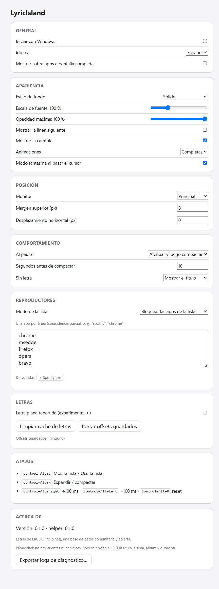
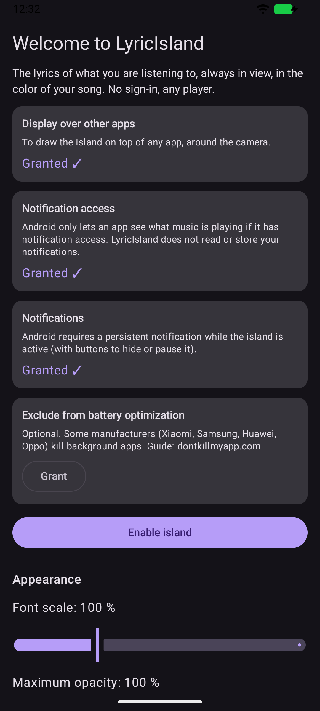

# Diseño de la isla

Referencia visual tomada de la app real. Las capturas usan las letras **inventadas** de `shared/fixtures`: en el repositorio no se guardan capturas con letras reales.

## Estados

| Estado | Captura | Windows | Android |
|---|---|---|---|
| EXPANDED |  | 560 × 84 px, radio 28 | ancho de pantalla − 24 dp × 88 dp, radio 28 dp |
| PAUSED |  | igual a EXPANDED, texto al 50 % + ❚❚ | igual |
| COMPACT |  | 240 × 38 px, radio 19 | ancho del cutout + 2 × 56 dp, alto del cutout + 8 dp |
| HIDDEN | — | opacidad 0, escala 0.85 | ventana de 1 dp |

Ajustes (Windows):  · Onboarding (Android): 

## Tokens

| Token | Valor | Uso |
|---|---|---|
| `background` | derivado de la carátula · OKLCH L 0.22–0.38, C ≤ 0.16 | fondo de la isla |
| `background-neutral` | `#1C1C1E` / alt `#2C2C2E` | sin carátula |
| `text-primary` | `#FFFFFF` | parte ya cantada (contraste ≥ 4.5 garantizado) |
| `text-upcoming` | `#FFFFFF73` (α 0.45) | parte por cantar |
| `text-secondary` | `#FFFFFF8C` (α 0.55) | línea siguiente, insignias |
| `accent` | LightVibrant o Vibrant con L 0.75 | ecualizador, interludio |
| Transición de color | 600 ms, ease-in-out, interpolación OKLCH | cambio de canción |
| Spring | rigidez 380, amortiguación 30 (Compose: dampingRatio 0.77) | expandir / compactar |
| Cambio de línea | sale −6 px en 100 ms · entra en 220 ms | karaoke |

## Tipografía

| Elemento | Windows | Android | Tamaño | Peso |
|---|---|---|---|---|
| Línea actual | Segoe UI Variable Display (Inter, Yu Gothic UI, Malgun Gothic, Microsoft YaHei) | fuente del sistema | 18 px / 17 sp | 600 |
| Línea siguiente | igual | igual | 13 px / 13 sp | 400 |
| Título (compacta) | igual | igual | 13 px / 13 sp | 500 |

Escala configurable del 80 % al 150 %; en Android se respeta `fontScale` con un tope de 1.3.
